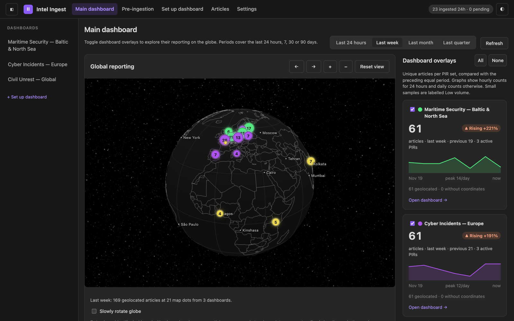
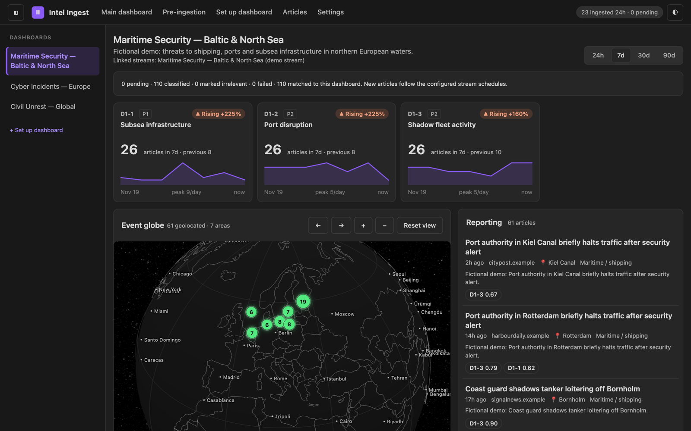
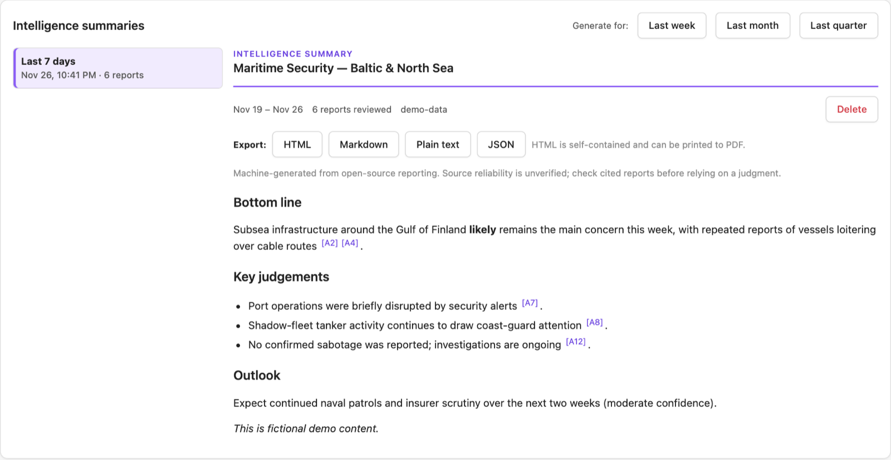
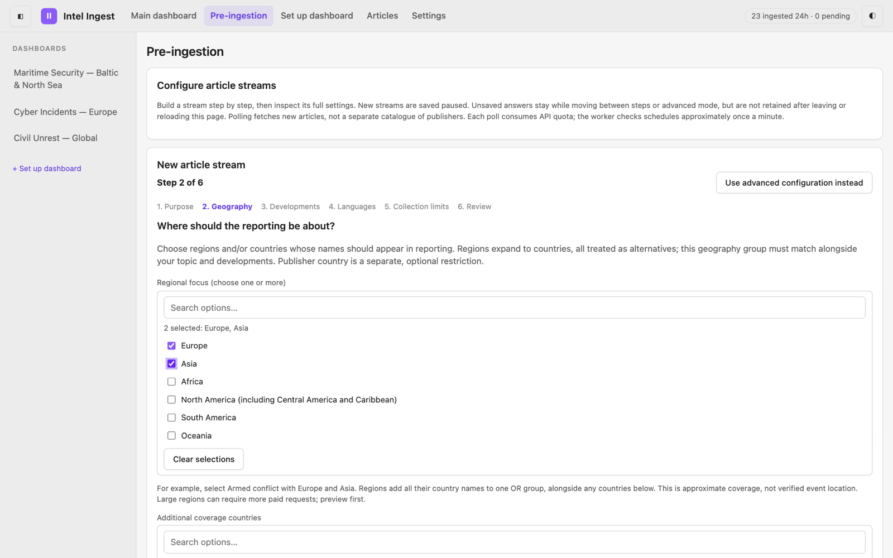
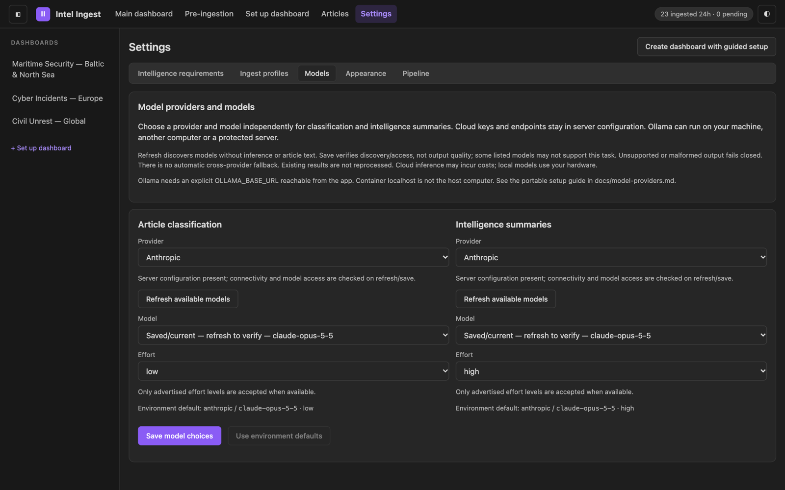
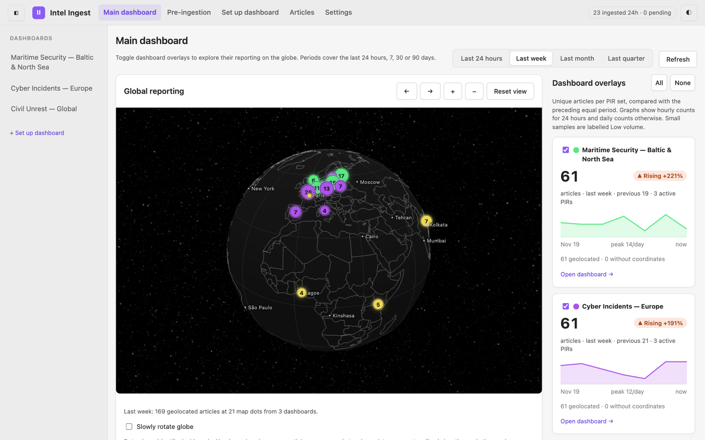
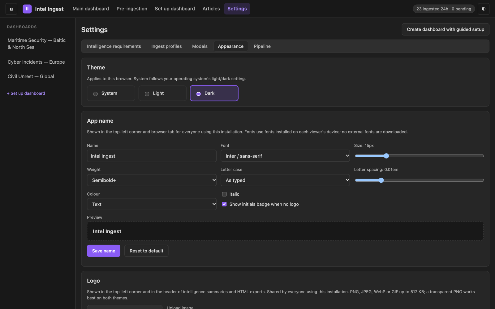

<div align="center">

# Intel Ingest

**Self-hosted open-source news intelligence.** Collect news from GDELT or NewsCatcher, classify every
article against your own intelligence requirements with the AI model of your choice, and explore the
results on an interactive globe with trends, feeds and cited period summaries.




<sub>All screenshots use fictional demo data (`python -m app.demo_seed`).</sub>

</div>

## Features

- **Dashboards built from your questions.** A guided setup turns your objective, scope and specific
  questions (Priority Intelligence Requirements, PIRs) into a dashboard. Every article is scored against them.
- **Interactive globe.** Events appear as dots coloured by dashboard; nearby articles are grouped into a
  numbered dot. Switch between the last 24 hours, week, month or quarter.
- **Trends at a glance.** Per-dashboard and per-requirement counts, sparklines and rising/falling signals
  compared with the previous period.
- **Cited intelligence summaries.** On-demand weekly, monthly or quarterly reports where every judgement links
  back to its sources. Export as HTML (print to PDF), Markdown, plain text or JSON.
- **Your choice of AI.** Anthropic, OpenAI, DeepSeek, Google Gemini or a local/remote **Ollama** model, chosen
  separately for classification and summaries. Keys stay on your server.
- **Guided stream setup.** Pick event categories, regions (e.g. *Armed conflict in Europe and Asia*) and
  languages; English keywords also find non-English reporting via translated-content search.
- **Make it yours.** Light and dark themes, your own logo and a custom app name.
- **Built to be safe to run.** New streams start paused, request and credit ceilings, previews before any paid
  call, deduplication so articles are classified once, and restart-safe background processing.

## Screenshots

| Dashboard with requirement trends | Cited intelligence summary |
|---|---|
|  |  |
| **Guided stream setup with regional focus** | **Choose AI providers per task** |
|  |  |
| **Light theme** | **Branding: logo, app name and theme** |
|  |  |

## Quick start

Requirements: [Docker Desktop](https://www.docker.com/products/docker-desktop/) (macOS/Windows) or Docker Engine (Linux).

```bash
git clone https://github.com/an3as-an3as/intel-ingest-public.git intel-ingest
cd intel-ingest
cp .env.example .env     # first install only: never overwrite an existing .env
# Edit .env: add an AI provider key (or an Ollama URL), set APP_PASSWORD and a strong POSTGRES_PASSWORD.
docker compose up -d --build
```

Open **http://localhost:8080**, then:

1. **Settings → Models**: choose a provider and model for classification and summaries.
2. **Pre-ingestion**: create a news stream (it starts paused) and preview its requests and cost.
3. **Set up dashboard**: describe what you want to monitor, then enable the stream.

Want to look around first? Load fictional demo data into an empty installation:

```bash
docker compose exec api python -m app.demo_seed --apply
```

The app listens only on `127.0.0.1`. See the [user guide](docs/user-guide.md#sharing-with-the-team-later)
before sharing it with others.

## How it works

```
 streams ─► GDELT / NewsCatcher ─► dedupe ─► article text ─► AI classification (1 call per article)
                                                              event type · location · summary · PIR scores
                                                                              │
                            ┌─────────────────────────────────────────────────┤
                            ▼                                                 ▼
               Articles feed (faceted)                 Dashboards: globe · trends · cited summaries
```

Streams are broad, source-side filters; the classifier does the precise sorting against your requirements.
Articles are stored once and shared between streams and dashboards.

## Configuration

Configure only what you use in `.env` (see [`.env.example`](.env.example)):

| What | Variables |
|---|---|
| AI providers | `ANTHROPIC_API_KEY`, `OPENAI_API_KEY`, `DEEPSEEK_API_KEY`, `GEMINI_API_KEY`, `OLLAMA_BASE_URL` |
| News sources | GDELT works without a key; `NEWSCATCHER_API_KEY` enables NewsCatcher |
| Access | `APP_PASSWORD` (shared HTTP Basic password) |

Step-by-step: **[Adding your own API keys](docs/api-keys.md)** · [Local and remote Ollama](docs/model-providers.md)

## Costs and data

AI calls and NewsCatcher searches are billed by those providers. Classification makes one model call per new
article, and each stream poll is one or more paid searches. Previews show request counts and estimated credits
before you save. Article text and your requirement wording are sent to the AI provider you choose; a local
Ollama model keeps inference on your own hardware. Check each provider's terms and pricing.

## Documentation

| Guide | |
|---|---|
| [User guide](docs/user-guide.md) | Streams, dashboards, globe, summaries, settings, pipeline health |
| [API keys](docs/api-keys.md) · [AI providers & Ollama](docs/model-providers.md) | Setup for each provider |
| [Stream setup](docs/stream-tutorial.md) · [Regions](docs/regional-focus.md) · [Multilingual matching](docs/english-content-matching.md) | Collecting the right reporting |
| [NewsCatcher filters](docs/newscatcher-filters.md) · [Keyword vocabularies](docs/event-vocabulary.md) | Query details |
| [Development](docs/development.md) · [Repository workflow](docs/repository.md) | Contributing and running tests |

More in [docs/](docs/README.md).

## Development

```bash
pip install -r backend/requirements-dev.txt
PYTHONPATH=backend python -m unittest discover -s backend/tests -q
node --test frontend/tests/*.test.mjs
```

Tests run offline with mocked providers. See [development](docs/development.md) for the isolated
development stack.

## Security

Never commit `.env`, API keys, database dumps or exported intelligence data. Report vulnerabilities privately;
see [SECURITY.md](SECURITY.md).

## License

See [LICENSE](LICENSE). Until a licence file is present, all rights are reserved.
